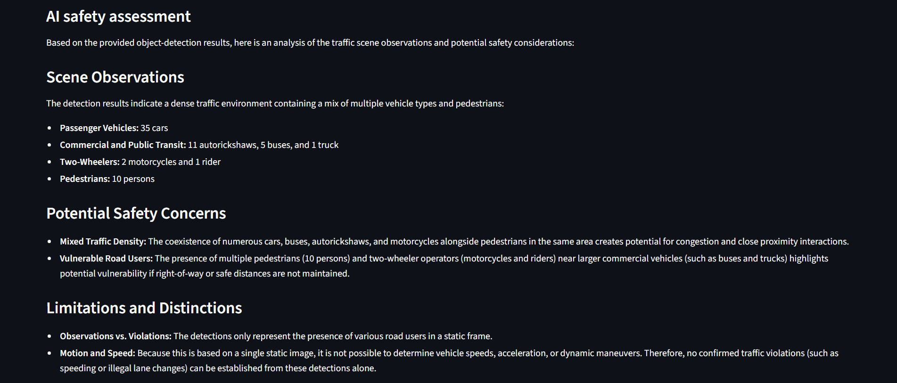
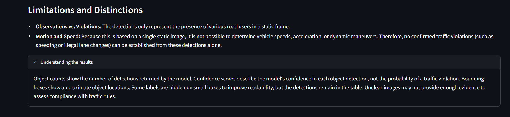

# Agentic Vision Assistant

An AI-powered traffic-scene analysis prototype combining a custom YOLO-based object detector, Retrieval-Augmented Generation (RAG), and Gemini-powered agentic tool calling to produce evidence-aware traffic safety assessments.

## Application Screenshots

### Main Interface


### Object Detection Dashboard


### Annotated Traffic Scene


### AI Safety Assessment



### Understanding Detection Limitations



## Overview

Agentic Vision Assistant analyzes traffic images, identifies visible road users and vehicles, retrieves relevant traffic-safety guidelines, and generates an evidence-aware scene assessment.

The application provides an interactive Streamlit interface with annotated images, object counts, detection confidence scores, bounding-box coordinates, and a natural-language safety assessment.

The system combines computer vision, semantic retrieval, and language-model-based tool calling. It is designed to distinguish detected objects from verified traffic violations and communicate uncertainty when the available visual evidence is insufficient.

## Key Features

- **Custom Object Detection:** Uses a custom YOLO-based model to identify road users and vehicles in traffic scenes.
- **Visual Annotations:** Draws bounding boxes and labels around detected objects.
- **Detection Dashboard:** Displays object counts, confidence scores, and bounding-box coordinates.
- **Retrieval-Augmented Generation:** Uses Sentence Transformers embeddings and FAISS similarity search to retrieve relevant traffic-safety guidelines.
- **Gemini-Powered Agent:** Interprets supplied detection evidence and retrieves relevant safety guidelines through tool calling when needed.
- **Evidence-Aware Assessment:** Generates explanations that distinguish visual observations from confirmed violations.
- **Traffic Detection Evaluation:** Includes a preliminary evaluation workflow using manually annotated images and Ultralytics validation metrics.
- **Automated Testing:** Includes pytest tests for object detection, agent evidence handling, and guideline retrieval.

## System Architecture

1. The user uploads a traffic image and enters a question through the Streamlit interface.
2. The custom YOLO-based detector identifies visible objects and returns their labels, confidence scores, and bounding-box coordinates.
3. The application displays the detections, annotated image, and detection statistics.
4. The application passes the detection evidence to the Gemini agent.
5. The agent uses the supplied detection results instead of running object detection again.
6. When relevant, the agent calls the RAG tool to retrieve information from the local traffic-safety knowledge base.
7. Gemini combines the supplied detection evidence and retrieved guideline information to generate a natural-language assessment.
8. The interface presents the assessment while communicating uncertainty and the limitations of static-image evidence.

## Technology Stack

| Component                       | Technology                          |
| ------------------------------- | ----------------------------------- |
| Programming language            | Python 3.11                         |
| Object detection                | Ultralytics YOLO-based custom model |
| Image processing                | OpenCV                              |
| Numerical computing             | NumPy                               |
| Text embeddings                 | Sentence Transformers               |
| Vector similarity search        | FAISS                               |
| Language model and tool calling | Google Gemini API                   |
| Web interface                   | Streamlit                           |
| Environment configuration       | python-dotenv                       |
| Automated testing               | pytest                              |
| Annotation format               | YOLO bounding-box format            |

## Project Structure

```text
Agentic-Vision-Assistant/
├── agent.py
├── app.py
├── detector.py
├── rag.py
├── evaluate_rag.py
├── test_agent.py
├── test_detector.py
├── test_rag.py
├── test.jpg
├── requirements.txt
├── .gitignore
├── README.md
├── docs/
│   └── safety_guidelines.txt
├── screenshots/
│   ├── user_interface.png
│   ├── dashboard.png
│   ├── detection_metrics.png
│   ├── ai_safety_assessment.png
│   └── limitations.png
├── models/
│   └── india_vru_best.pt
└── evaluation/
    ├── classes.txt
    ├── dataset.yaml
    ├── coco_dataset.yaml
    ├── build_coco_dataset.py
    ├── evaluate_detector.py
    ├── evaluate_map.py
    ├── run_standard_validation.py
    ├── prepare_coco_labels.py
    ├── preview_annotations.py
    ├── validate_annotations.py
    ├── images/
    ├── labels/
    ├── coco_labels/
    ├── preview/
    └── results/
```

The structure above lists the principal project files and directories. Some generated evaluation files and model weights are maintained locally and may not be included in the repository.

The `evaluation/` directory contains traffic images, manually prepared YOLO annotations, dataset-building and validation scripts, annotation previews, and evaluation outputs. Generated datasets can be recreated locally from the source images and labels.

The `models/` directory is excluded from version control. The custom checkpoint must be obtained separately and placed at `models/india_vru_best.pt` before running the detector.

## Getting Started

### 1. Clone the Repository

```powershell
git clone https://github.com/Praneetha-as29/Agentic-Vision-Assistant.git
cd Agentic-Vision-Assistant
```

### 2. Create and Activate a Virtual Environment

```powershell
python -m venv .venv
.\.venv\Scripts\Activate.ps1
```

If PowerShell blocks script execution, use Command Prompt instead:

```bat
.venv\Scripts\activate.bat
```

### 3. Install Dependencies

```powershell
python -m pip install -r requirements.txt
```

### 4. Configure the Detection Model

Obtain the custom checkpoint `india_vru_best.pt` and place it in the following location:

```text
models/india_vru_best.pt
```

The detector expects this checkpoint at that path. The model weights are not included in the Git repository.

### 5. Configure the Gemini API Key

Create a file named `.env` in the project root and add your Gemini API key:

```text
GEMINI_API_KEY=your_api_key_here
```

Replace the placeholder with your own key obtained through Google AI Studio.

**Security:** Never commit `.env` or expose your API key in screenshots, source code, or public logs. The project's `.gitignore` excludes `.env` files.

### 6. Run the Web Application

```powershell
python -m streamlit run app.py
```

Open the local URL printed in the terminal, normally:

[http://localhost:8501](http://localhost:8501)

Upload a traffic image, enter a question, and use the application to view the detections and generated safety assessment.

### 7. Run Object Detection Independently

```powershell
python detector.py test.jpg
```

Replace `test.jpg` with the path to another image when needed.

### 8. Query the Local Safety Knowledge Base

```powershell
python rag.py
```

Enter a traffic-safety question when prompted.

### 9. Run the Agent from the Terminal

```powershell
python agent.py test.jpg "Describe the visible traffic scene and potential safety concerns."
```

The agent uses the detector's results as evidence and can retrieve relevant safety guidelines when needed.

### 10. Run Automated Tests

```powershell
python -m pytest -v
```

The test suite covers detection output validation, missing-image handling, agent evidence requirements, prompt construction, guideline loading, and retrieval behavior.

## Object Detection Evaluation

### Earlier YOLOv8n Baseline

A preliminary baseline evaluation was conducted using two manually annotated traffic-scene images. These results belong to the earlier pretrained YOLOv8n model, not the currently configured custom detector.

The original annotation dataset contains six classes:

- Person
- Car
- Bus
- Motorcycle
- Truck
- Auto-rickshaw

The annotations were exported in YOLO format and checked for valid class IDs, normalized coordinates, positive bounding-box dimensions, and boxes contained within image boundaries. Preview images were generated to support visual inspection.

Because the pretrained COCO model does not have a dedicated auto-rickshaw class, auto-rickshaw annotations were excluded from the COCO-compatible baseline evaluation.

### Preliminary Baseline Results

| Metric                           | Result |
| -------------------------------- | -----: |
| Precision                        | 80.35% |
| Recall                           | 56.10% |
| mAP\@0.5                         | 74.75% |
| mAP\@0.5:0.95                    | 32.17% |
| Evaluation images                |      2 |
| Supported ground-truth instances |     43 |

**Environment:** Ultralytics 8.4.177, YOLOv8n, Python 3.11.9, CPU inference.

These metrics are preliminary measurements from a very small pilot dataset. They should not be interpreted as representative of general traffic-scene detection performance or as measurements of the current custom checkpoint.

### Per-Class Baseline Results

| Class      | Precision | Recall | mAP\@0.5 | mAP\@0.5:0.95 |
| ---------- | --------: | -----: | -------: | ------------: |
| Person     |     89.5% |  57.0% |    72.5% |         37.6% |
| Car        |     97.9% |  17.4% |    59.3% |         24.1% |
| Motorcycle |     59.6% | 100.0% |    99.5% |         49.7% |
| Bus        |     74.4% |  50.0% |    67.7% |         17.2% |

The motorcycle results are based on a single annotated instance, so they do not establish consistent performance for that class.

### Baseline Observations

- The model detected several prominent vehicles and road users in the evaluated scenes.
- The low car recall indicated that many annotated cars were not successfully matched under the validation settings.
- The difference between mAP\@0.5 and mAP\@0.5:0.95 indicated that localization quality needed further investigation.
- Visual inspection showed missed objects and some questionable predictions in crowded traffic scenes.
- The small sample size made these results sensitive to the specific images and annotations selected.

### Evaluation Limitations

- Only two images were used for the baseline evaluation.
- Manual annotations may contain boundary or labeling inconsistencies.
- The pretrained COCO model did not provide a dedicated auto-rickshaw detection class.
- The dataset was not sufficiently large or diverse to establish general model performance.
- The evaluation did not establish whether a detected road user was violating traffic rules.

### Future Detection Evaluation

- Expand the dataset with more traffic images from different locations, lighting conditions, and traffic densities.
- Independently review ground-truth annotations and class assignments.
- Evaluate the custom checkpoint on a held-out, manually annotated dataset.
- Calculate precision, recall, and mAP for the custom model using compatible class mappings and documented evaluation settings.
- Compare the custom model against the earlier baseline under the same evaluation conditions.

## Retrieval-Augmented Generation Evaluation

The RAG component retrieves traffic-safety guideline passages using Sentence Transformers and FAISS.

A preliminary retrieval evaluation was conducted using ten manually defined queries aligned with the existing guideline collection. The revised test set achieved **10/10 successful retrievals at Recall\@3 (100%)**.

This result describes the small, manually constructed test set only. It does not establish general retrieval quality across arbitrary traffic-safety questions.

Further evaluation should use a broader set of independent queries, manually assessed relevance labels, and more diverse guideline content.

## Limitations

- The custom detector identifies visual object categories; it is not a dedicated traffic-violation classifier.
- Object detection alone cannot establish whether a person is wearing a compliant helmet or seatbelt.
- A single image cannot reliably establish speed, movement, right-of-way, or the full context of a traffic event.
- Detection errors can affect the accuracy of the generated assessment.
- Language-model responses may be incomplete or incorrect, even when detection evidence is supplied.
- Gemini API access requires network connectivity and is subject to model availability and usage limits.
- The existing object-detection metrics describe an initial baseline, not a production-level benchmark for the custom detector.

### Understanding Detection Results

Object counts represent the number of detections returned by the model. Confidence scores indicate the model's confidence in an individual detection, not the probability of a traffic violation. Bounding boxes indicate approximate object locations. Labels may be hidden on smaller boxes to improve readability, while the detections remain available in the results table. Unclear images may not provide sufficient evidence to assess compliance with traffic rules.

This project is an educational prototype and should not be used as the sole basis for real-world traffic enforcement or safety decisions.

## Future Improvements

- Evaluate the custom detector on a larger and more diverse traffic dataset.
- Compare the custom checkpoint with the earlier baseline using consistent evaluation settings.
- Add dedicated helmet and seatbelt detection where suitable datasets and models are available.
- Improve retrieval quality and evaluate relevance across different queries.
- Expand automated tests and add structured evaluation metrics.
- Improve logging, API failure handling, and deployment readiness.
- Explore evaluation using independent test data and more comprehensive traffic-scene scenarios.

## Project Status

Working prototype with custom object detection, local safety-guideline retrieval, Gemini-powered tool calling, a Streamlit dashboard, automated tests, and an initial evaluation workflow for the earlier YOLOv8n baseline.

## License

No license has been selected yet. A suitable license should be added before explicitly permitting reuse or redistribution.
