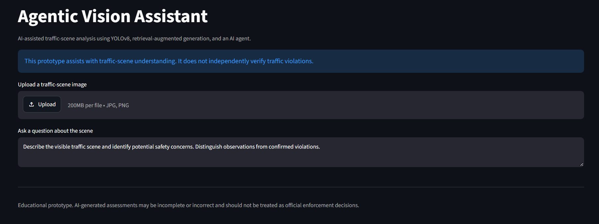
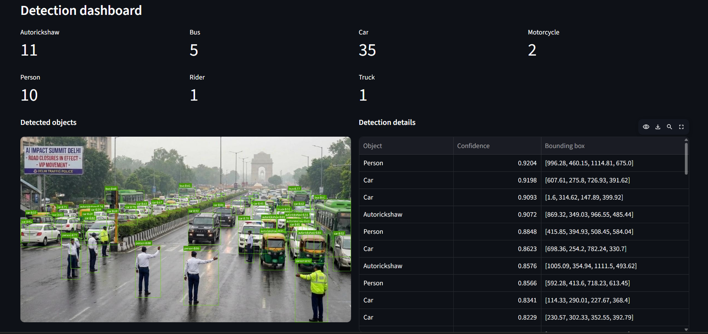
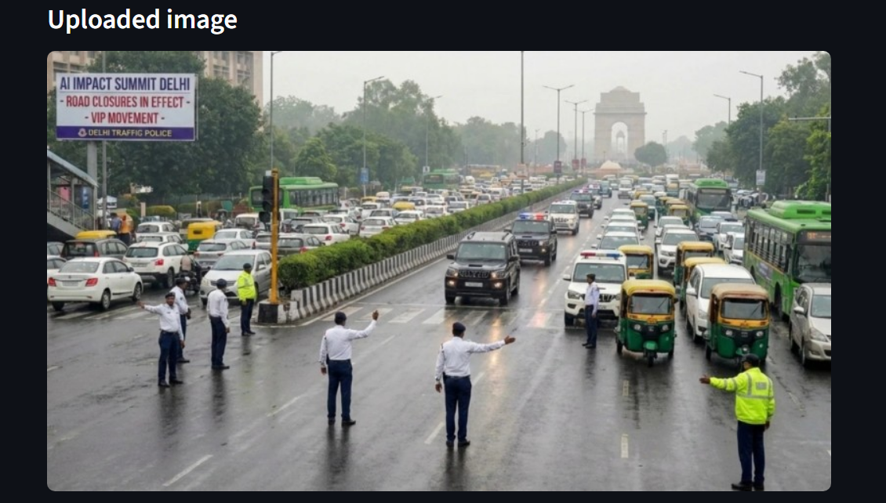
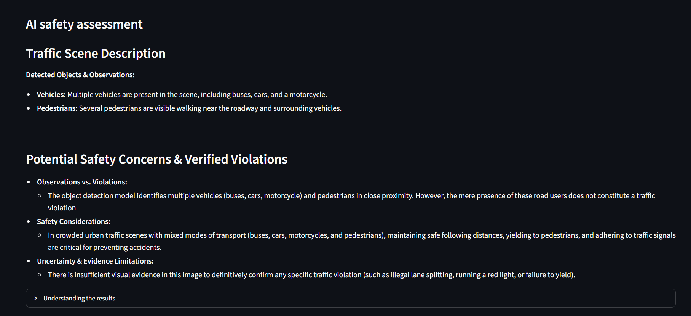

# Agentic Vision Assistant

An AI-powered traffic-scene analysis prototype combining YOLOv8 object detection, Retrieval-Augmented Generation (RAG), and Gemini-powered agentic tool calling to produce evidence-aware traffic safety assessments.

## Application Screenshots

### Main Interface



### Object Detection Dashboard



### Annotated Traffic Scene



### AI Safety Assessment



## Overview

Agentic Vision Assistant analyzes traffic images, identifies visible objects, retrieves relevant traffic-safety guidelines, and generates an evidence-aware scene assessment.

The application provides an interactive Streamlit interface with annotated images, object counts, detection confidence scores, bounding-box coordinates, and a natural-language safety assessment.

The system combines computer vision, semantic retrieval, and language-model-based tool calling. It is designed to distinguish detected objects from verified traffic violations and communicate uncertainty when the available visual evidence is insufficient.

## Key Features

- **Object Detection:** Uses pretrained YOLOv8 to identify objects in traffic scenes.
- **Visual Annotations:** Draws bounding boxes and labels around detected objects.
- **Detection Dashboard:** Displays object counts, confidence scores, and bounding-box coordinates.
- **Retrieval-Augmented Generation:** Uses Sentence Transformers embeddings and FAISS similarity search to retrieve relevant traffic-safety guidelines.
- **Agentic Tool Calling:** Uses the Gemini API to coordinate object detection and safety-guideline retrieval.
- **Evidence-Aware Assessment:** Generates explanations that distinguish visual observations from confirmed violations.
- **Traffic Detection Evaluation:** Includes a preliminary evaluation workflow using manually annotated images and Ultralytics validation metrics.
- **Automated Testing:** Includes pytest tests for object detection and guideline retrieval.

## System Architecture

1. The user uploads a traffic image and enters a question through the Streamlit interface.
2. YOLOv8 detects visible objects and returns labels, confidence scores, and bounding-box coordinates.
3. The application displays the detections, annotated image, and detection statistics.
4. The Gemini agent can call the object-detection and safety-guideline retrieval tools.
5. The RAG component retrieves relevant passages from local safety-guideline documents using Sentence Transformers and FAISS.
6. The agent combines the available evidence into a natural-language traffic-scene assessment.
7. The interface presents the results while highlighting evidence limitations and uncertainty.

## Technology Stack

| Component | Technology |
|---|---|
| Programming language | Python 3.11 |
| Object detection | Ultralytics YOLOv8 |
| Image processing | OpenCV |
| Numerical computing | NumPy |
| Text embeddings | Sentence Transformers |
| Vector similarity search | FAISS |
| Language model and tool calling | Google Gemini API |
| Web interface | Streamlit |
| Automated testing | pytest |
| Annotation format | YOLO bounding-box format |

## Project Structure

```text
Agentic-Vision-Assistant/
├── agent.py
├── app.py
├── detector.py
├── rag.py
├── evaluate_rag.py
├── test_detector.py
├── test_rag.py
├── test.jpg
├── requirements.txt
├── .gitignore
├── README.md
├── docs/
│   └── safety_guidelines.txt
├── screenshots/
│   ├── User_Interface.png
│   ├── dashboard.png
│   ├── detection_metrics.png
│   ├── safety_assessment.png
│   └── upload_interface.png
└── evaluation/
    ├── classes.txt
    ├── dataset.yaml
    ├── coco_dataset.yaml
    ├── coco_dataset_full.yaml
    ├── evaluate_detector.py
    ├── evaluate_map.py
    ├── run_standard_validation.py
    ├── prepare_coco_labels.py
    ├── preview_annotations.py
    ├── validate_annotations.py
    ├── images/
    ├── labels/
    ├── coco_labels/
    ├── coco_dataset/
    ├── preview/
    └── results/
```

The `evaluation/` directory contains the pilot traffic images, manually prepared YOLO annotations, dataset-building and validation scripts, annotation previews, and evaluation visualizations. The COCO-compatible dataset is generated locally by `build_coco_dataset.py` and is excluded from version control because it can be recreated from the original images and labels.

## Getting Started

### 1. Clone the Repository

```powershell
git clone https://github.com/Praneetha-as29/Agentic-Vision-Assistant.git
cd Agentic-Vision-Assistant
```

### 2. Create and Activate a Virtual Environment

```powershell
python -m venv .venv
.\.venv\Scripts\Activate.ps1
```

If PowerShell blocks script execution, use Command Prompt instead:

```bat
.venv\Scripts\activate.bat
```

### 3. Install Dependencies

```powershell
python -m pip install -r requirements.txt
```

### 4. Configure the Gemini API Key

Create a file named `.env` in the project root and add your Gemini API key:

```text
GEMINI_API_KEY=your_api_key_here
```

Replace the placeholder with your own key obtained through Google AI Studio.

**Security:** Never commit `.env` or expose your API key in screenshots, source code, or public logs. The project's `.gitignore` excludes `.env` files.

### 5. Run the Web Application

```powershell
python -m streamlit run app.py
```

Open the local URL printed in the terminal, normally:

[http://localhost:8501](http://localhost:8501)

Upload a traffic image, enter a question, and select **Analyze traffic scene** to view object detections and the generated safety assessment.

### 6. Run Object Detection Independently

```powershell
python detector.py test.jpg
```

### 7. Query the Local Safety Knowledge Base

```powershell
python rag.py
```

Enter a traffic-safety question when prompted.

### 8. Run the Agent from the Terminal

```powershell
python agent.py test.jpg "Describe the visible traffic scene and potential safety concerns."
```

### 9. Run Automated Tests

```powershell
python -m pytest -v
```

The test suite covers object-detection output validation, missing-image handling, guideline loading, empty queries, and retrieval results.

## YOLOv8 Object Detection Evaluation

### Evaluation Setup

A preliminary evaluation was conducted using two manually annotated traffic-scene images.

The original annotation dataset contains six classes:

- Person
- Car
- Bus
- Motorcycle
- Truck
- Auto-rickshaw

The annotations were exported in YOLO format and checked for valid class IDs, normalized coordinates, positive bounding-box dimensions, and boxes contained within image boundaries. Preview images were generated to support visual inspection.

The pretrained YOLOv8n model was evaluated using the Ultralytics validation pipeline. Because the pretrained COCO model does not have a dedicated auto-rickshaw class, auto-rickshaw annotations were excluded from the COCO-compatible baseline evaluation.

### Preliminary Results

| Metric | Result |
|---|---:|
| Precision | 80.35% |
| Recall | 56.10% |
| mAP@0.5 | 74.75% |
| mAP@0.5:0.95 | 32.17% |
| Evaluation images | 2 |
| Supported ground-truth instances | 43 |

**Environment:** Ultralytics 8.4.177, YOLOv8n, Python 3.11.9, CPU inference.

These metrics are preliminary measurements from a very small pilot dataset. They should not be interpreted as representative of general traffic-scene detection performance.

### Per-Class Results

| Class | Precision | Recall | mAP@0.5 | mAP@0.5:0.95 |
|---|---:|---:|---:|---:|
| Person | 89.5% | 57.0% | 72.5% | 37.6% |
| Car | 97.9% | 17.4% | 59.3% | 24.1% |
| Motorcycle | 59.6% | 100.0% | 99.5% | 49.7% |
| Bus | 74.4% | 50.0% | 67.7% | 17.2% |

The motorcycle results are based on a single annotated instance, so they do not establish consistent performance for that class.

### Observations

- The model detects several prominent vehicles and road users in the evaluated scenes.
- The low car recall indicates that many annotated cars were not successfully matched under the validation settings.
- The difference between mAP@0.5 and mAP@0.5:0.95 indicates that localization quality should be investigated further.
- Visual inspection shows missed objects and some questionable predictions in crowded traffic scenes.
- The small sample size makes these results sensitive to the specific images and annotations selected.

### Evaluation Limitations

- Only two images were used for the pilot evaluation.
- Manual annotations may contain boundary or labeling inconsistencies.
- The pretrained COCO model does not provide a dedicated auto-rickshaw detection class.
- The dataset is not sufficiently large or diverse to establish general model performance.
- The evaluation does not establish whether a detected road user is violating traffic rules.

### Future Evaluation Improvements

- Expand the dataset with more traffic images from different locations, lighting conditions, and traffic densities.
- Independently review ground-truth annotations and class assignments.
- Evaluate a dedicated auto-rickshaw detector trained or fine-tuned on appropriately labeled data.
- Compare the pretrained model with improved or specialized detection models.
- Track precision, recall, and mAP across a larger held-out evaluation dataset.

## Retrieval-Augmented Generation Evaluation

The RAG component retrieves traffic-safety guideline passages using Sentence Transformers and FAISS.

A preliminary retrieval evaluation was conducted using ten manually defined queries aligned with the existing guideline collection. The revised test set achieved **10/10 successful retrievals at Recall@3 (100%)**.

This result describes the small, manually constructed test set only. It does not establish general retrieval quality across arbitrary traffic-safety questions.

Further evaluation should use a broader set of independent queries, manually assessed relevance labels, and more diverse guideline content.

## Limitations

- The pretrained YOLOv8 model detects general object categories; it is not a dedicated traffic-violation classifier.
- Object detection alone cannot establish whether a person is wearing a compliant helmet or seatbelt.
- A single image cannot reliably establish speed, movement, right-of-way, or the full context of a traffic event.
- Language-model responses may be incomplete or incorrect.
- Gemini API access requires network connectivity and is subject to model availability and usage limits.
- The current object-detection evaluation is an initial pilot, not a production-level benchmark.

This project is an educational prototype and should not be used as the sole basis for real-world traffic enforcement or safety decisions.

## Future Improvements

- Evaluate object detection on a larger and more diverse traffic dataset.
- Add dedicated helmet, seatbelt, and auto-rickshaw detection where suitable datasets are available.
- Improve retrieval quality and evaluate relevance across different queries.
- Expand automated tests and add structured evaluation metrics.
- Improve logging, API failure handling, and deployment readiness.
- Explore a more comprehensive evaluation pipeline with independent test data.

## Project Status

Working prototype with object detection, local safety-guideline retrieval, Gemini agentic tool calling, a Streamlit dashboard, automated tests, and an initial object-detection evaluation workflow.

## License

No license has been selected yet. A suitable license should be added before explicitly permitting reuse or redistribution.
